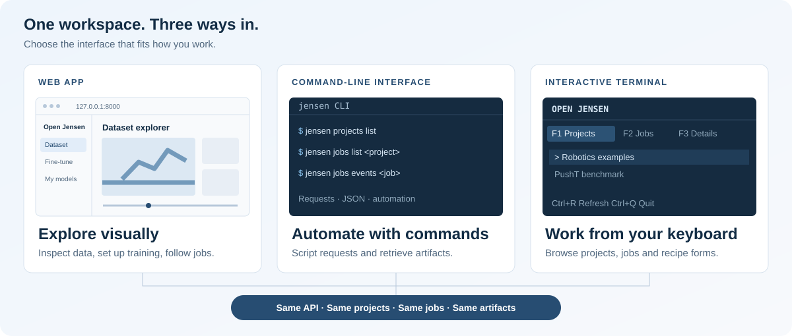
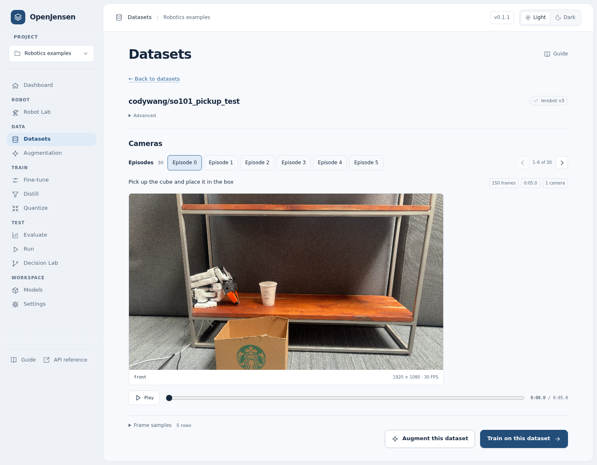

# OPEN JENSEN

**Joint Embodied Neural Simulation & Execution Network**

**Inspect robot data, train policies, and prepare models for native inference.**

OPEN JENSEN brings dataset exploration, training, quantization and simulation into one self-hosted workspace. Interact with it through the **web app**, the **`jensen` command-line interface (CLI)**, or the **optional interactive terminal client (TUI)**. All three connect to the same application API and share projects, jobs and artifacts. Training and simulation run in separate worker environments, locally or on configured cloud compute.

[Get started](#run-locally) · [Workspace guide](docs/workspace-guide.md) · [Requirements and support](docs/support.md) · [Backup and upgrade](docs/upgrading.md)



| Interface | Open it | Use it for |
| --- | --- | --- |
| [Web app](docs/workspace-guide.md) | Start `uv run --frozen jensen serve`, then open `http://127.0.0.1:8000` | Visual dataset exploration, training setup and job monitoring. |
| [CLI](docs/terminal.md#follow-lifecycle-jobs-from-the-cli) | `uv run --frozen jensen projects list` | Scriptable requests, job events and artifact downloads. |
| [Interactive terminal (TUI)](docs/terminal.md) | `uv run --frozen --extra tui jensen tui` | Keyboard-driven project and job views, dataset intake and recipe review. |

Keep the application server running for the CLI and TUI. Install the optional terminal dependencies with `uv sync --frozen --all-packages --extra tui`; see the [terminal guide](docs/terminal.md) for connecting either client to another server.



*Browse recorded episodes and inspect their camera views, state and action samples.*

## What you can do

| Sector | In the workspace |
| --- | --- |
| Robot Lab | Set up an SO-101 arm from the computer it is plugged into: assign motor IDs, calibrate, teleoperate and record LeRobot v3 episodes. |
| Dataset | Inspect public LeRobot v2/v3 datasets, play camera recordings and review sampled state/action rows. Validate local v3 datasets into immutable training copies. |
| Fine-tune | Choose a policy and compatible compute, follow loss and progress, resume supported runs, and download checkpoints with their training settings. |
| Distill | Train an ACT256 student from an ACT (Action Chunking with Transformers) teacher using selected observations, actions and episode splits. |
| Quantize | Convert SmolVLA checkpoints to GGUF with Q8 or Q4 language-weight quantization. Export completed ACT checkpoints as FP32 inference packages, then create packed INT8/INT4 ACT packages. |
| Evaluate / Run | Measure native inference, inspect full packed ACT predictions on recorded observations, run configured LIBERO evaluations, or launch an ACT/SmolVLA Isaac simulation. |
| Teaching / Augmentation | Record demonstrations through the Teaching interface, connect optional voice services, or review appearance-augmentation candidates before reusing them. |
| Decision lab | Compare text criteria with the configured local Muose scorer. |
| Cloud runs / Settings | Review saved cloud activity, configure connections and compute, and inspect project diagnostics. |

Robot Lab, Teaching, Augmentation, Decision lab and Cloud runs are optional modules: they appear in the sidebar once the host is set up for them (see [installation profiles](docs/installation-profiles.md#workspace-modules)). Each operation needs a worker that matches the policy, dataset format and available hardware. Some advanced workflows remain experimental; check [requirements and support](docs/support.md) before choosing a runtime.

[OPEN JENSEN Quant](workers/jensen_quant/README.md) is a 4/8-bit quantization library and CLI for dense PyTorch models. Use its native ACT packing path from the workspace or its standalone library and command-line client.

## Run locally

Build from source with **Python 3.14.7**, **uv 0.12.19**, **Node 24.21.0** and **pnpm 12.6.0**. Node builds the frontend; Python serves the running application. The desktop client currently connects to this server; a self-contained desktop installer remains experimental.

The command-line client is `jensen`. Application configuration uses `JENSEN_*` settings, and new workspace data defaults to `.jensen/`. Existing alpha workspaces are preserved; see [upgrade compatibility](docs/upgrading.md#alpha-compatibility).

Clone the repository, then install and run from its root:

```sh
git clone https://github.com/OpenJensen/openjensen.git
cd openjensen
uv sync --frozen
uv venv --python 3.14.7 workers/_cpu_readers/.venv
uv pip install --python workers/_cpu_readers/.venv/bin/python --no-deps -r workers/_cpu_readers/requirements.txt
pnpm install --frozen-lockfile
pnpm build:web
uv run --frozen jensen serve
```

Open [localhost:8000](http://127.0.0.1:8000). The reader requirements include Parquet, NumPy, HDF5 and image support. Install FFmpeg/ffprobe on the application host for local video imports and immutable training copies. Windows uses `workers/_cpu_readers/.venv/Scripts/python.exe`; its source setup is experimental. Use Linux for NVIDIA training and Isaac workers.

The core application and metadata intake need no GPU or provider key. Public Hub inspection needs network access. Training, native inference, simulation, voice and augmentation need their own configured workers or services. The server listens on loopback at the address above.

For tool-version fallbacks, development mode, local dataset configuration and CLI examples, see the [getting started guide](docs/getting-started.md).

For native ACT distillation and packed observation replay, use the separate
[local CPU worker setup](workers/local_cpu/README.md) to install dependencies
and configure the runtimes. For native ACT quantization, configure the
[registered packing worker](workers/jensen_quant/NATIVE_ACT.md).

### Your first project

1. Open the project menu, choose **Create project**, and give it a name.
2. Open **Dataset → Sources**, select **Hugging Face**, and enter `codywang/so101_pickup_test` in **Dataset repository**.
3. Expand **Revision (optional)** and enter `ecef85bc07005f771ad86deeff1427f9d72953ed` to use the pinned example.
4. Select **Inspect dataset**. After inspection succeeds, the episode list and first episode's camera previews load automatically. Select an episode, use **Play** and the playback slider, and open **Frame samples → Action** to inspect sampled actions.

This first workflow needs network access and the CPU reader, with no GPU or provider key. Stop the server with `Ctrl+C`; the project remains in its workspace for your next launch.

When you are ready to train, follow [compute setup](docs/compute-settings.md) and [native training](docs/native-training.md). Local and cloud workers require separate environments. Review the recipe and cloud billing consent before starting a job. For import examples, configuration and common errors, see [getting started](docs/getting-started.md).

## Documentation

Start with the [workspace guide](docs/workspace-guide.md) for a short explanation of every sector. The app also serves it at [`/guide/`](http://127.0.0.1:8000/guide/) through the **Guide** link on desktop and mobile.

| Topic | Guides |
| --- | --- |
| Workspace | [Sector guide](docs/workspace-guide.md), [frontend development](docs/workbench-design.md) |
| Setup and compute | [Getting started](docs/getting-started.md), [requirements and support](docs/support.md), [backup and upgrade](docs/upgrading.md), [compute settings](docs/compute-settings.md), [cloud training](docs/skypilot-training.md) |
| Datasets | [Dataset imports](docs/dataset-import.md), [local training and Teaching](docs/local-training.md), [appearance augmentation](docs/augmentation.md) |
| Policies and artifacts | [Training adapters](docs/native-training.md), [native policy workflow](docs/policy-workflow.md), [ACT export](docs/cloud-act-export.md), [ACT distillation](workers/policy_distillation/README.md), [cloud artifact storage](docs/cloud-artifact-storage.md) |
| Local optimization | [CPU worker setup](workers/local_cpu/README.md), [native ACT packing](workers/jensen_quant/NATIVE_ACT.md), [recorded-observation replay](workers/isaac_sim/NATIVE_REPLAY.md) |
| Evaluation and simulation | [Native Isaac](docs/native-simulation.md), [LIBERO Spatial](docs/spatial-workflow.md), [cloud inference](docs/cloud-inference.md), [cloud run monitoring](docs/cloud-runs.md) |
| Other clients | [Terminal workbench](docs/terminal.md), [desktop connector](apps/desktop/README.md), [Unity viewer](apps/unity/com.openjensen.teaching-viewer/README.md) |
| Optional AI services | [Voice connections](docs/teaching-connections.md), [Muose decision worker](workers/decision/README.md), [Jev and Mk1.5 proposals](workers/teaching/PROVIDERS.md) |
| Development | [Development checks](docs/ci.md) |

The separate [`/docs/`](http://127.0.0.1:8000/docs/) route serves the [API reference](http://127.0.0.1:8000/docs/) and [OpenAPI schema](http://127.0.0.1:8000/openapi.json).

## Architecture

The Python application owns persistent projects, job state and artifact records. Isolated workers own model-specific dependencies and execution. OPEN JENSEN adopts LeRobot, SkyPilot and native runtimes instead of maintaining a second implementation of each trainer or simulator.

```text
apps/web/          Next.js and React interface, exported as static files
packages/core/     Python API, CLI, optional TUI, SQLite and job orchestration
workers/           Isolated training, inference, simulation and data workers
apps/desktop/      Tauri connector to a separately running local application
apps/unity/        Receive-only simulation viewer
tests/             Core, worker-contract and browser integration checks
docs/              Setup guides and workflow documentation
```

New project data lives in `.jensen/` by default. Set `JENSEN_DATA_DIR` to choose a persistent absolute directory, and start one application process for each workspace. Cloud training stores checkpoints in private GCS; a local workspace backup preserves their references and does not copy those remote objects.

The deployment scope is a single-user application on loopback, with an SSH tunnel for remote access. See [security guidance](SECURITY.md) before changing its network exposure.

## Install only the components you use

Core, Robot Lab, Dataset tools, Training and Simulation have separate installation profiles. Run `jensen install list` to see their requirements, `jensen install robot --dry-run` to inspect a plan, and `jensen install robot --check` to check an existing environment. Training and simulation keep their own runtimes; adding USB hardware support does not install a CUDA stack or download models. See [installation profiles](docs/installation-profiles.md) and [SO-101 Robot Lab](docs/so101-robot-lab.md).

## Development

After installing the pinned dependencies:

```sh
uv run --frozen pytest -q
uv run --frozen ruff check packages/core scripts tests
uv run --frozen ruff format --check packages/core scripts tests
pnpm check:web
pnpm format:check
pnpm lint:web
pnpm build:web
pnpm exec playwright install chromium
pnpm test:web
```

Workers keep separate environments and checks. Do not hand-edit generated API types. Follow [development checks](docs/ci.md) for optional terminal checks, schema generation and platform requirements, and [contribution guidance](CONTRIBUTING.md) when proposing a change.

## License

Project code is licensed under [Apache License 2.0](LICENSE); see [NOTICE](NOTICE). Third-party code, model weights, datasets and assets retain their own terms and attribution. Check their source terms before reuse or redistribution.

[Versions and update channels](docs/versioning.md) distinguish the installed package, source commit and published release.
