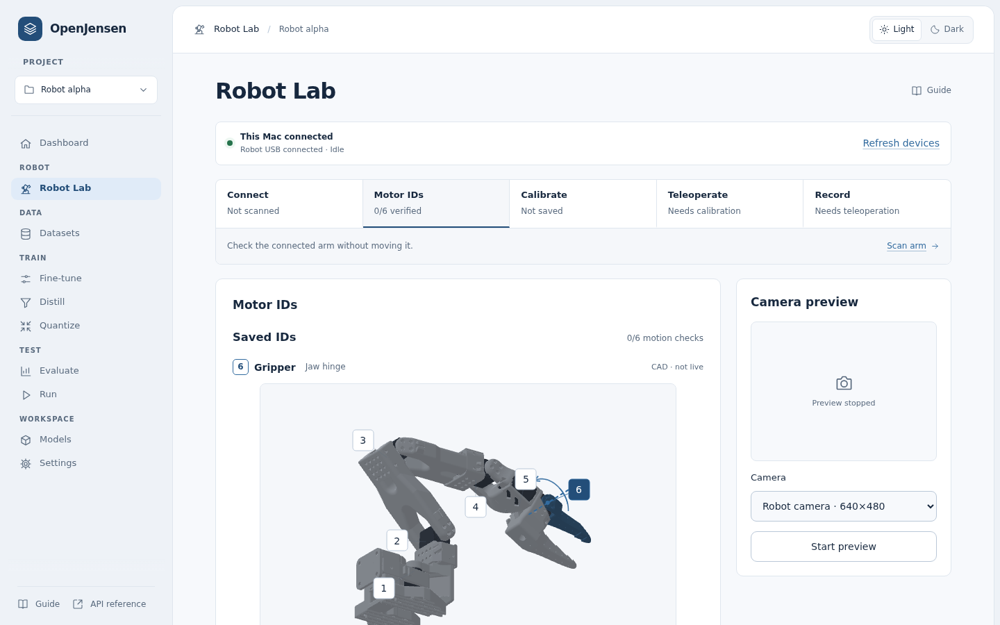

# OpenJensen

**An open-source workspace for robot learning.** Record demonstrations on a real arm, inspect datasets, fine-tune and compress robot policies, and test them in simulation, all from one self-hosted web app.



[Quick start](#quick-start) · [Workspace guide](docs/workspace-guide.md) · [What runs where](docs/support.md) · [Contributing](CONTRIBUTING.md)

## What you can do

| Page | What it does |
| --- | --- |
| **Initial setup** | Set up an SO-101 arm from the computer it is plugged into: assign motor IDs, calibrate, teleoperate with on-screen controls or a leader arm, and record LeRobot v3 episodes into a project. |
| **AI teleoperation** | Give Astra a task goal, review bounded actions and their measured results, or record Isaac demonstrations. Physical SO101 control uses supervised acceptance. See [setup and limits](docs/agent-control.md). |
| **Datasets** | Inspect public LeRobot v2/v3 datasets from Hugging Face, or import local folders, ZIP and HDF5 files. Play all cameras in sync and read state and action samples. |
| **Augmentation** | Generate appearance variations of recorded clips and review them before reuse. |
| **Fine-tune** | Train SmolVLA, ACT, π₀, π₀.₅, GR00T N1.7, Diffusion Policy and [more](#supported-policies) on a local NVIDIA GPU or cloud GPUs. Follow loss live, resume runs and download checkpoints. |
| **Distill** | Train a small ACT student from an ACT teacher. |
| **Quantize** | Convert SmolVLA to GGUF (Q8 or Q4) and pack ACT to INT8 or INT4. |
| **Evaluate** | Check a policy's loading, action validity and speed, or measure task success on LIBERO Spatial. |
| **Run** | Run a policy in Isaac simulation, or replay it on recorded observations. |
| **Decision Lab** | Score text criteria with a small local model (experimental). |
| **Models** | Browse every checkpoint and derived model with its history, and start the next step from it. |
| **Cloud runs** | Follow jobs running on cloud GPUs. |

The `jensen` [command line](docs/terminal.md#follow-lifecycle-jobs-from-the-cli) and an optional [terminal UI](docs/terminal.md) work with the same projects and jobs through the same API, for scripting and keyboard-driven use.


*Dataset: [codywang/so101_pickup_test](https://huggingface.co/datasets/codywang/so101_pickup_test) (Apache-2.0).*

## Quick start

You need Python 3.14.7, [uv](https://docs.astral.sh/uv/) 0.12.19, Node 24.21.0 and pnpm 12.6.0. No GPU or cloud account is needed to start.

```sh
git clone https://github.com/OpenJensen/openjensen.git
cd openjensen
uv sync --frozen
uv venv --python 3.14.7 workers/_cpu_readers/.venv
uv pip install --python workers/_cpu_readers/.venv/bin/python --no-deps -r workers/_cpu_readers/requirements.txt
pnpm install --frozen-lockfile
pnpm build:web
uv run --frozen jensen serve
```

Open [localhost:8000](http://127.0.0.1:8000), create a project, and try a public dataset:

1. Open **Datasets**, choose **Hugging Face**, and enter `codywang/so101_pickup_test`.
2. Select **Inspect dataset**, pick an episode and press **Play**.

Install FFmpeg on the same machine to import local videos. The [getting started guide](docs/getting-started.md) covers local data, the CLI and troubleshooting.

## Add what you need

The core app runs on any machine. Robots, GPUs and simulators are added separately, so you only install what you use. Once something is set up, its page appears in the sidebar; **Settings → Modules** shows what each one needs.

| To | Install | Guide |
| --- | --- | --- |
| Use an SO-101 arm | The Robot Lab companion on the macOS or Linux computer the arm is plugged into | [SO-101 Robot Lab](docs/so101-robot-lab.md) |
| Train on your GPU | A local training worker (Linux, NVIDIA) | [Compute settings](docs/compute-settings.md) |
| Train on cloud GPUs | A Google Cloud connection; jobs launch through SkyPilot | [Cloud training](docs/skypilot-training.md) |
| Distill, pack or replay ACT | The CPU workers (Apple Silicon macOS or Linux) | [CPU workers](workers/local_cpu/README.md) |
| Quantize SmolVLA | The native GGUF runtime | [Policy workflow](docs/policy-workflow.md) |
| Simulate or teach in simulation | Isaac Sim 6.1 (Linux, NVIDIA) | [Simulation](docs/native-simulation.md) |

`jensen install list` shows each installation profile; `jensen install robot --dry-run` previews one. See [installation profiles](docs/installation-profiles.md).

## Supported policies

- **Training:** SmolVLA (LoRA, QLoRA or full), ACT, Diffusion Policy, π₀, π₀-FAST, π₀.₅, GR00T N1.7, EO-1, EVO-1, Multi-Task DiT, VLA-JEPA, VQ-BeT, WALL-X, XVLA and Psi-Zero. SmolVLA is the most complete path; the others are experimental. OpenVLA and OpenVLA-OFT need an operator-provided adapter.
- **Robots:** SO-101 arms with Feetech servos, as follower or leader.
- **Datasets:** LeRobot v2 and v3 from Hugging Face or local folders; robomimic and ALOHA HDF5; folders of images with frame records. See [dataset import](docs/dataset-import.md).

The repository also includes [OpenJensen Quant](workers/jensen_quant/README.md), a standalone 4- and 8-bit quantization library and CLI for PyTorch models.

## Status

OpenJensen is alpha software (0.1) for a single user on their own machines. The server listens on localhost; use an SSH tunnel for remote access and read the [security notes](SECURITY.md) before exposing it. Distillation, Q4 quantization, Isaac simulation, adapter training beyond SmolVLA, assembled-arm motor setup and Windows installs are experimental. [What runs where](docs/support.md) lists requirements and limits for each workflow.

## Documentation

- **Use the workspace:** [Workspace guide](docs/workspace-guide.md) · [Getting started](docs/getting-started.md) · [Dataset import](docs/dataset-import.md) · [SO-101 Robot Lab](docs/so101-robot-lab.md) · [Teaching](docs/managed-teaching.md) · [Augmentation](docs/augmentation.md)
- **Train and deploy policies:** [Native training](docs/native-training.md) · [Policy workflow](docs/policy-workflow.md) · [ACT quantization](docs/native-act-quantization.md) · [LIBERO Spatial](docs/spatial-workflow.md) · [Isaac simulation](docs/native-simulation.md)
- **Set up compute:** [Compute settings](docs/compute-settings.md) · [Cloud connections](docs/cloud-connections.md) · [Cloud training](docs/skypilot-training.md) · [Installation profiles](docs/installation-profiles.md)
- **Run a server:** [Deploy on a Linux server](deploy/linux-server/README.md) · [Backup and upgrade](docs/upgrading.md) · [Versions](docs/versioning.md)
- **Other clients:** [Terminal](docs/terminal.md) · [Desktop connector](apps/desktop/README.md) · [Unity viewer](apps/unity/com.openjensen.teaching-viewer/README.md)

The running app serves the workspace guide at `/guide/` and the API reference at `/docs/`.

## How it is built

The Python application owns projects, jobs and artifacts. Each model, simulator and robot runs in its own worker environment, so heavy dependencies stay out of the core app. OpenJensen builds on LeRobot, SkyPilot and the models' own runtimes rather than reimplementing them.

```text
apps/web/          Next.js interface, exported as static files
packages/core/     Python API, CLI, terminal UI and job orchestration (SQLite)
workers/           Training, inference, simulation, robot and data workers
apps/desktop/      Tauri desktop connector
apps/unity/        Simulation viewer
tests/             Core, worker-contract and browser tests
docs/              Guides
```

## Development

```sh
uv run --frozen pytest -q
uv run --frozen ruff check packages/core scripts tests
uv run --frozen ruff format --check packages/core scripts tests
pnpm check:web
pnpm format:check
pnpm lint:web
pnpm build:web
pnpm exec playwright install chromium
pnpm test:web
```

Workers keep their own environments and checks. See [development checks](docs/ci.md), [writing documentation](docs/writing-docs.md) and [contributing](CONTRIBUTING.md).

## License

[Apache License 2.0](LICENSE); see [NOTICE](NOTICE). Third-party code, model weights, datasets and assets keep their own licenses.
